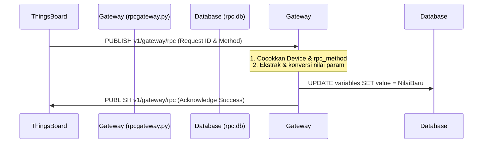

# Dokumentasi Integrasi MQTT ThingsBoard Gateway

Dokumen ini menjelaskan detail penggunaan MQTT, termasuk topik (*topic*) dan struktur data (*payload*) yang digunakan untuk komunikasi antara **ThingsBoard** dan **RPC Gateway** berdasarkan file [rpcgateway.py](file:///e:/KERJA/thingsboard-gateway/rpcgateway.py).

---

## 1. Konfigurasi Koneksi MQTT

Gateway terhubung ke broker MQTT ThingsBoard menggunakan parameter berikut:
*   **Host / IP**: Diambil dari database (pengaturan `tb_ip`).
*   **Port**: Diambil dari database (pengaturan `tb_port`, default `1883`).
*   **Credentials**: Menggunakan Access Token gateway sebagai **Username** (`username=tb_token`). Password dikosongkan.

---

## 2. Pengiriman Telemetri (Gateway $\rightarrow$ ThingsBoard)

Gateway secara periodik (setiap 1 detik jika terhubung) mengirimkan data status variabel semua perangkat ke ThingsBoard.

*   **Topic**: `v1/gateway/telemetry`
*   **Method**: `PUBLISH` (QoS = 1)
*   **Format Payload**: JSON Object berisi pasangan nama perangkat dan daftar nilai variabelnya.

### Contoh Payload Telemetri:
```json
{
  "Device_A": [
    {
      "temperature": 25,
      "status": 1
    }
  ],
  "Device_B": [
    {
      "humidity": 60,
      "valve_state": 0
    }
  ]
}
```

---

## 3. Kontrol RPC (ThingsBoard $\rightarrow$ Gateway)

ThingsBoard dapat mengirimkan perintah kontrol (Remote Procedure Call/RPC) ke gateway untuk mengubah nilai variabel perangkat.

### A. Request RPC (ThingsBoard $\rightarrow$ Gateway)
*   **Topic**: `v1/gateway/rpc`
*   **Method**: `SUBSCRIBE` (Gateway berlangganan ke topik ini)
*   **Format Payload**:
    ```json
    {
      "device": "NamaDevice",
      "id": 123,
      "data": {
        "method": "NamaMethodRPC",
        "params": {
          "NamaVariabel": "NilaiBaru"
        }
      }
    }
    ```
    *Atau `params` bisa berupa nilai langsung (bukan object).*

#### Detail Pencocokan dan Pengolahan Parameter:
1.  **Pencocokan Perangkat & Method**:
    *   Gateway mencari nama perangkat (`device`) secara *case-insensitive*.
    *   Gateway mencari variabel yang memiliki kolom `rpc_method` sesuai dengan `method` yang diterima (secara *case-insensitive*).
2.  **Ekstraksi Nilai (`extract_param_value`)**:
    *   Jika `params` berupa JSON Object (dict):
        *   Dicari key yang namanya mirip dengan nama variabel (setelah menghapus prefix `set`, spasi, dan karakter non-alfanumerik secara *case-insensitive*).
        *   Jika tidak ditemukan, mencari key `"value"`.
        *   Jika tidak ditemukan, mencari key `"params"`.
        *   Jika objek hanya memiliki 1 key/properti, maka nilai properti tersebut langsung diambil.
    *   Jika `params` bukan JSON Object (misal boolean, integer, atau string langsung), nilainya langsung digunakan.
3.  **Konversi Nilai (`parse_int_value`)**:
    Semua nilai yang diterima akan dikonversi ke Integer (`0` atau `1` untuk status/boolean, atau integer asli untuk angka):
    *   `True` / `"true"` / `"on"` / `"yes"` / `"active"` $\rightarrow$ `1`
    *   `False` / `"false"` / `"off"` / `"no"` / `"inactive"` $\rightarrow$ `0`
    *   Angka (integer/float) $\rightarrow$ dikonversi ke `int`
    *   Jika gagal diurai $\rightarrow$ default ke `1`

---

### B. Response / Acknowledgment RPC (Gateway $\rightarrow$ ThingsBoard)
Setelah gateway sukses memproses RPC dan memperbarui database lokal, gateway mengirimkan konfirmasi kembali ke broker untuk memberi tahu ThingsBoard bahwa perintah berhasil dieksekusi.

*   **Topic**: `v1/gateway/rpc`
*   **Method**: `PUBLISH` (QoS = 1)
*   **Format Payload**:
    ```json
    {
      "device": "NamaDevice",
      "id": 123,
      "data": {
        "success": true,
        "message": "Variable 'NamaVariabel' updated to NilaiBaru."
      }
    }
    ```

---

## Ringkasan Alur RPC


